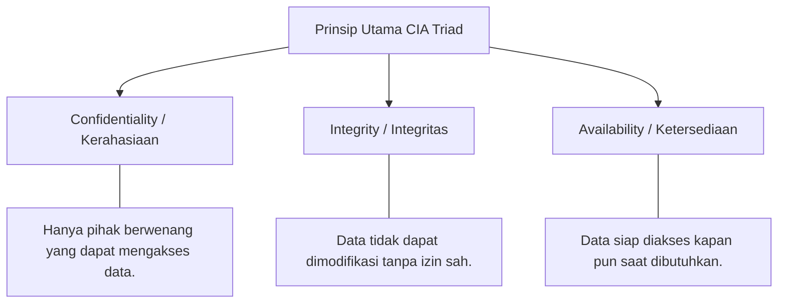

# 🛡️ Security Awareness (Kesadaran Keamanan Informasi & Siber)

Selamat datang di repositori **Security Awareness**. Repositori ini didedikasikan untuk mengulas materi kesadaran keamanan informasi dan siber secara komprehensif dalam bahasa Indonesia yang lugas, interaktif, dan mudah dipahami oleh siapa saja—mulai dari akademisi, pegawai instansi, hingga masyarakat umum.

*   **Judul Materi:** *Security Awareness (Kesadaran Keamanan Siber & Informasi)*
*   **Pemateri / Kontributor:** Anton Lepari & Komunitas Kamar Kamsib
*   **Output Pembelajaran:**
    *   🛡️ Menyadari pentingnya menjaga kerahasiaan dan integritas data di ruang siber.
    *   ⚠️ Mampu mengenali berbagai bentuk serangan siber aktual yang menargetkan individu maupun instansi.
    *   🔒 Memahami langkah-langkah praktis untuk memproteksi diri dan memitigasi insiden kebocoran data.
*   **Media Pembelajaran:** Webinar, Panduan Tekstual (GitHub)

---

## 📌 Daftar Isi

1. [📊 Statistik Serangan Siber di Indonesia (Terbaru 2025/2026)](#-statistik-serangan-siber-di-indonesia-terbaru-20252026)
2. [🚀 Bagaimana Saya Memulai dari Nol?](#-bagaimana-saya-memulai-dari-nol)
3. [🔑 Prinsip Keamanan Informasi (CIA Triad)](#-prinsip-keamanan-informasi-cia-triad)
4. [👔 Mengapa Saya Harus Aware?](#-mengapa-saya-harus-aware)
    * [3.1 Klasifikasi Data & Informasi](#31-klasifikasi-data--informasi)
    * [3.2 Panduan Umum Pengamanan Dokumen](#32-panduan-umum-pengamanan-dokumen)
    * [3.3 Macam-Macam Pengamanan TIK](#33-macam-macam-pengamanan-tik)
5. [⚠️ Jenis Serangan Siber Terkini](#-jenis-serangan-siber-terkini)
    * [4.1 Ransomware & Kasus PDNS 2](#41-ransomware--kasus-pdns-2)
    * [4.2 Social Engineering (Rekayasa Sosial)](#42-social-engineering-rekayasa-sosial)
    * [4.3 Phishing & Modus APK WhatsApp](#43-phishing--modus-apk-whatsapp)
    * [4.4 Brute-Force & Kekuatan Password](#44-brute-force--kekuatan-password)
6. [📈 Evaluasi Indeks KAMI](#-evaluasi-indeks-kami)
7. [🌐 Standar Keamanan Global (ISO/IEC 27001)](#-standar-keamanan-global-isoiec-27001)
8. [🏫 Keamanan Digital untuk Sekolah](#-keamanan-digital-untuk-sekolah)
9. [📚 Repositori Artikel & Regulasi](#-repositori-artikel--regulasi)

---

## 📊 Statistik Serangan Siber di Indonesia (Terbaru 2025/2026)

Menurut data resmi pemantauan dari **Badan Siber dan Sandi Negara (BSSN)**, ruang siber Indonesia menghadapi eskalasi ancaman yang belum pernah terjadi sebelumnya:

```
[Tren Anomali Trafik/Serangan Siber di Indonesia]

  Tahun | Jumlah Serangan/Anomali
  ------+-----------------------------------------
  2024  | 📈 370+ Juta serangan
  2025  | 🔥 5,5 Miliar serangan (Naik 714%)
  2026* | ⚡ 1,52 Miliar serangan (*Hingga 15 April 2026)
```

> [!IMPORTANT]
> **Mengapa Terjadi Lonjakan Drastis pada 2025–2026?**
> Penyerang siber kini memanfaatkan teknologi kecerdasan buatan (**Artificial Intelligence / AI**) untuk melakukan otomatisasi serangan secara massal, memutasi *malware* secara cepat (*behavior-based attack*), serta menyusun pesan phishing yang sangat meyakinkan. Hal ini menuntut kita untuk selalu memperbarui pengetahuan keamanan kita secara berkala.

---

## 🚀 Bagaimana Saya Memulai dari Nol?

Sering kali muncul pertanyaan:
> *"Saya ingin belajar tentang hacking, pentesting, manajemen keamanan informasi, atau cyber security secara umum. Tapi bingung harus mulai dari mana?"*

Jawabannya adalah **mulai dari dasar kesadaran diri sendiri**. Keamanan siber bukan hanya tentang mengetik perintah rumit di terminal (*hacker-style*), melainkan bagaimana kita melindungi data pribadi dan hak akses kita. Pintu gerbang utama Anda adalah mempelajari repositori ini dan bergabung dalam komunitas **Kamar Kamsib**.

---

## 🔑 Prinsip Keamanan Informasi (CIA Triad)

Dalam dunia keamanan informasi, pilar pertahanan utama ditopang oleh konsep klasik bernama **CIA Triad** (Confidentiality, Integrity, Availability):



*   **Confidentiality (Kerahasiaan):** Menjamin bahwa informasi hanya dapat diakses oleh pihak yang memiliki hak akses resmi. Mencegah kebocoran data (*data breach*).
*   **Integrity (Integritas):** Menjamin bahwa data tetap utuh, akurat, dan tidak dimodifikasi secara tidak sah dari pengiriman hingga penyimpanan.
*   **Availability (Ketersediaan):** Menjamin bahwa sistem dan data siap digunakan oleh pengguna yang sah kapan pun dibutuhkan. Mencegah kelumpuhan operasional akibat serangan seperti DDoS atau Ransomware.

---

## 👔 Mengapa Saya Harus Aware?

Sebagai pribadi maupun bagian dari organisasi, kita adalah baris pertahanan terdepan. Kelalaian satu orang dapat membuka celah keamanan bagi seluruh instansi.

### 3.1 Klasifikasi Data & Informasi

Tidak semua data diperlakukan sama. Berdasarkan regulasi resmi di Indonesia, data diklasifikasikan sebagai berikut:

#### A. Menurut [PMK Nomor 133/PMK.01/2022](133_PMK.01_2022.pdf):
| Klasifikasi | Deskripsi | Contoh |
| :--- | :--- | :--- |
| **Sangat Rahasia** | Dampak sangat berat bagi negara/organisasi jika bocor | Strategi nasional, kunci enkripsi negara |
| **Rahasia** | Dampak berat bagi organisasi/unit kerja jika bocor | Data pribadi pegawai lengkap, dokumen audit internal |
| **Terbatas** | Dampak sedang/terbatas pada internal organisasi | SOP internal kerja yang belum dirilis |
| **Publik** | Dapat dikonsumsi oleh masyarakat luas tanpa risiko keamanan | Siaran pers resmi, brosur, konten website |

#### B. Menurut [Peraturan BSSN Nomor 8 Tahun 2020](Peraturan_BSSN_Nomor_8_Tahun_2020.pdf):
*   **Sangat Rahasia**
*   **Rahasia dan/atau Terbatas**
*   **Biasa (Publik)**

---

### 3.2 Panduan Umum Pengamanan Dokumen

*   ❌ **Clean Desk Policy:** Jangan meninggalkan dokumen sensitif tergeletak di atas meja kerja tanpa pengawasan.
*   🖨️ **Secure Printing:** Jangan mencetak dokumen penting di printer umum tanpa langsung mengambil hasilnya.
*   🗣️ **Social Awareness:** Jangan mendiskusikan informasi internal kantor di tempat umum (kafe, transportasi umum).
*   💾 **Fasilitas Resmi:** Jangan menyimpan berkas kedinasan di penyimpanan *cloud* pribadi (seperti Google Drive personal) atau perangkat milik pribadi tanpa enkripsi.
*   🗑️ **Document Shredding:** Hancurkan fisik dokumen sensitif (menggunakan *shredder*) sebelum membuangnya ke tempat sampah.

---

### 3.3 Macam-Macam Pengamanan TIK

Untuk membentengi diri, kita harus memperhatikan beberapa aspek keamanan berikut:
1.  **Pengamanan Area:** Mengunci ruangan server, membatasi akses pengunjung fisik.
2.  **Pengamanan Perangkat:** Mengaktifkan kunci layar otomatis, enkripsi penyimpanan (seperti BitLocker/FileVault).
3.  **Penggunaan Kata Sandi:** Tidak memakai password yang mudah ditebak atau sama di banyak akun.
4.  **Jaringan Internal:** Selalu gunakan VPN resmi saat mengakses sistem kantor dari jaringan luar.
5.  **E-mail & Media Sosial:** Membatasi informasi pribadi yang diposting dan waspada terhadap e-mail asing.
6.  **Penggunaan Wi-Fi:** Hindari bertransaksi finansial atau login sistem penting saat menggunakan Wi-Fi publik gratis.

---

## ⚠️ Jenis Serangan Siber Terkini

Di bawah ini adalah topik-topik serangan siber yang paling rawan terjadi. Silakan klik tautan untuk membaca panduan lengkap dan mendalam:

### 4.1 Ransomware & Kasus PDNS 2
Ransomware adalah *malware* yang menyandera data dengan cara mengenkripsinya, lalu meminta tebusan uang. 
*   📖 Baca materi selengkapnya di: [**Panduan Kesadaran Ransomware**](ransomware/README.md) *(Termasuk studi kasus serangan Brain Cipher pada PDNS 2 Indonesia).*

### 4.2 Social Engineering (Rekayasa Sosial)
Teknik manipulasi psikologis korban untuk menyerahkan informasi sensitif (seperti PIN, OTP, atau password) secara sukarela karena panik, takut, atau tergiur hadiah.
*   📖 Baca materi selengkapnya di: [**Panduan Menghadapi Social Engineering**](soceng/README.md)

### 4.3 Phishing & Modus APK WhatsApp
Upaya memancing korban untuk memberikan data sensitif melalui situs web palsu atau menginstal aplikasi berbahaya (.APK) yang menyamar sebagai kurir paket atau undangan pernikahan.
*   📖 Baca materi selengkapnya di: [**Panduan Deteksi & Mitigasi Phishing**](phishing/README.md) *(Termasuk langkah tanggap darurat jika telanjur mengeklik).*

### 4.4 Brute-Force & Kekuatan Password
Metode peretasan akun dengan menebak kombinasi password secara berulang kali menggunakan kamus kata sandi otomatis.
*   📖 Baca materi selengkapnya di: [**Panduan Manajemen Password & Brute-Force**](brute-force/README.md)

---

## 📈 Evaluasi Indeks KAMI

**Indeks KAMI (Keamanan Informasi)** adalah alat evaluasi untuk menganalisis tingkat kesiapan pengamanan informasi di suatu organisasi berdasarkan standar ISO/IEC 27001.
*   📖 Pelajari instrumen evaluasi ini di: [**Panduan & Template Indeks KAMI**](Indeks-KAMI/README.md)

---

## 🌐 Standar Keamanan Global (ISO/IEC 27001)

Bagaimana organisasi berstandar internasional mengelola keamanan informasinya? ISO/IEC 27001 adalah jawabannya.
*   📖 Baca penjelasan transisi standarisasi terbaru di: [**Mengenal Standar ISO/IEC 27001**](iso27001/README.md)

---

## 🏫 Keamanan Digital untuk Sekolah

Materi edukasi khusus yang dirancang untuk membangun kesadaran keamanan digital sejak dini bagi siswa, guru, dan institusi pendidikan.
*   📖 Lihat silabus dan materi di: [**Keamanan Siber di Lingkungan Sekolah**](materi-sekolah/README.md)

---

## 📚 Repositori Artikel & Regulasi

Kumpulan berkas PDF asli regulasi nasional serta artikel mendalam mengenai *Cyber Kill Chain* dan kerentanan web.
*   📖 Akses katalog dokumen di: [**Katalog Artikel & Regulasi Kamsib**](docs/README.md)

---

## 📞 Referensi Tepercaya & Bantuan
*   **Badan Siber dan Sandi Negara (BSSN):** [bssn.go.id](https://bssn.go.id)
*   **Layanan Aduan Konten Negatif / Penipuan Kominfo:** [aduankonten.id](https://aduankonten.id)
*   **Portal Laporan Rekening Penipuan Nasional:** [cekrekening.id](https://cekrekening.id)
*   **Portal Keamanan Siber Nasional BSSN CSIRT:** [gov-csirt.bssn.go.id](https://gov-csirt.bssn.go.id)
