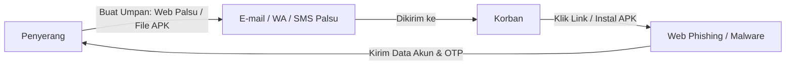

# 🎣 Kesadaran Keamanan Siber: Mendeteksi & Menangkal Phishing

Phishing adalah salah satu teknik serangan siber tertua, namun tetap menjadi yang paling efektif dan sering memakan korban hingga saat ini. Namanya merupakan pelesetan dari kata bahasa Inggris **"fishing"** (memancing), karena cara kerjanya yang menggunakan "umpan" untuk menjebak korban.

---

## 🔍 Apa itu Phishing?

**Phishing** adalah upaya penipuan untuk mendapatkan informasi sensitif korban—seperti *username*, *password*, nomor kartu kredit, PIN, hingga kode OTP—dengan cara menyamar sebagai institusi atau individu tepercaya melalui saluran komunikasi elektronik (Email, WhatsApp, SMS, Telepon).

---

## 🚀 Modus Phishing Terpopuler di Indonesia

Para pelaku kejahatan siber sangat adaptif dan memanfaatkan tren sosial untuk mengelabui masyarakat Indonesia. Berikut adalah beberapa modus aktual yang sangat marak:

### 1. Modus File APK WhatsApp (SMS Stealer)
Ini adalah salah satu ancaman paling berbahaya yang memakan banyak korban di Indonesia sejak tahun 2023 hingga sekarang.
*   **Kedok Penyamaran:** Pelaku mengirim pesan WhatsApp dengan menyamar sebagai:
    *   📦 **Kurir Paket:** *"Permisi kak, ada paket atas nama kakak. Tolong cek foto paketnya ya."* (mengirim berkas `Foto_Paket_J&T.apk`).
    *   💌 **Undangan Pernikahan Digital:** *"Kami mengharapkan kehadiran Bapak/Ibu..."* (mengirim berkas `Undangan_Digital_Rian.apk`).
    *   🚔 **Surat Tilang E-TLE:** *"Kendaraan Anda terdeteksi melanggar lalu lintas..."* (mengirim berkas `Surat_Tilang_Online.apk`).
    *   🏥 **Tagihan BPJS / PLN:** *"Mohon segera melunasi tunggakan tagihan Anda..."* (mengirim berkas `Rincian_Tagihan_BPJS.apk`).
*   **Cara Kerjanya:** File tersebut bukanlah foto atau dokumen PDF asli, melainkan aplikasi Android (.APK) berbahaya berjenis **SMS Stealer** (atau RAT). Begitu diinstal dan diberi izin akses SMS, aplikasi ini secara diam-diam akan meneruskan semua SMS yang masuk (terutama SMS berisi kode OTP m-banking dan e-wallet) ke Telegram atau server milik pelaku. Pelaku kemudian dapat menguras saldo rekening korban dengan mudah.

### 2. Modus Perubahan Tarif Transfer Bank
*   **Kedok Penyamaran:** Pelaku menyamar sebagai pihak bank resmi (misalnya Bank BCA, BRI, Mandiri) dan mengirimkan pesan bahwa tarif transfer antarbank akan naik dari Rp 6.500 per transaksi menjadi Rp 150.000 per bulan flat.
*   **Umpan:** Korban diminta mengisi formulir persetujuan penolakan kenaikan tarif melalui link phishing yang disediakan (misalnya: `bca-tarif-baru-indonesia.com`).
*   **Pencurian Data:** Halaman web tersebut meniru persis tampilan web resmi bank. Korban dituntun memasukkan nomor kartu ATM, nomor HP, PIN, dan kode OTP transaksi. Begitu dimasukkan, penipu langsung menguras dana korban dari sistem mereka.

---

## 🚨 Panduan Tanggap Darurat: Jika Terlanjur Klik/Instal APK

Jika Anda atau orang terdekat tidak sengaja mengunduh dan menginstal aplikasi APK mencurigakan tersebut, **segera lakukan langkah-langkah darurat berikut untuk meminimalkan kerugian:**

> [!IMPORTANT]
> **TINDAKAN SEGERA (Jangan Ditunda!)**
> 1.  ✈️ **Aktifkan Mode Pesawat (Flight Mode):** Matikan koneksi internet (data seluler dan Wi-Fi) di ponsel tersebut secepatnya. Langkah ini memutus jalur transmisi data antara ponsel Anda dan server peretas, menghentikan pengiriman SMS/OTP secara *real-time*.
> 2.  ⚙️ **Copot Pemasangan (Uninstall) Aplikasi:** Masuk ke **Pengaturan (Settings) > Aplikasi (Apps) / Manajemen Aplikasi**. Cari aplikasi mencurigakan yang baru saja Anda instal (biasanya menggunakan ikon generik tanpa gambar yang jelas, nama kurir/undangan, tetapi ukuran filenya kecil). Klik **Uninstall** (Hapus Instalan).
> 3.  📞 **Hubungi Bank Resmi:** Gunakan perangkat lain untuk menghubungi *call center* resmi bank Anda (misalnya Halo BCA, Contact BRI). Laporkan bahwa Anda terkena modus APK dan minta mereka **memblokir sementara** layanan m-banking, e-banking, dan kartu ATM Anda.
> 4.  🔑 **Ganti Kata Sandi (Password):** Dari perangkat lain yang aman, ganti segera kata sandi email utama, media sosial, dan akun-akun penting yang terhubung dengan ponsel yang terinfeksi.
> 5.  🔄 **Factory Reset (Langkah Teraman):** Untuk memastikan tidak ada *malware* atau *trojan backdoor* yang tertinggal di sistem ponsel, lakukan cadangan (*backup*) data penting secara manual, lalu lakukan **Reset Setelan Pabrik (Factory Reset)** pada ponsel tersebut.

---

## 🛡️ Cara Mencegah Penipuan Phishing

*   🔍 **Perhatikan Ekstensi File:** Dokumen atau foto asli di WhatsApp biasanya berformat `.pdf`, `.jpg`, `.png`, atau `.docx`. Jika ada berkas berakhiran `.apk` (atau memiliki nama ganda seperti `Undangan.pdf.apk`), **jangan pernah dibuka atau diinstal!**
*   🚫 **Matikan Fitur Instalasi Sumber Tak Dikenal:** Di menu keamanan Android Anda, pastikan opsi *"Install from Unknown Sources"* (Instal dari Sumber Tidak Dikenal) dinonaktifkan agar aplikasi dari luar Google Play Store tidak bisa terinstal otomatis.
*   📞 **Konfirmasi Jalur Resmi:** Pihak kurir ekspedisi, polisi lalu lintas, BPJS, maupun pihak bank **tidak pernah** mengirimkan surat tilang, foto paket, atau pembaruan tarif dalam bentuk aplikasi file `.apk` melalui WhatsApp pribadi. Lakukan verifikasi ke nomor call center resmi instansi bersangkutan jika ragu.
*   💡 **Gunakan Otentikasi Non-SMS:** Jika memungkinkan, gunakan aplikasi autentikator (seperti Google Authenticator) alih-alih OTP berbasis SMS untuk akun-akun sensitif Anda.
