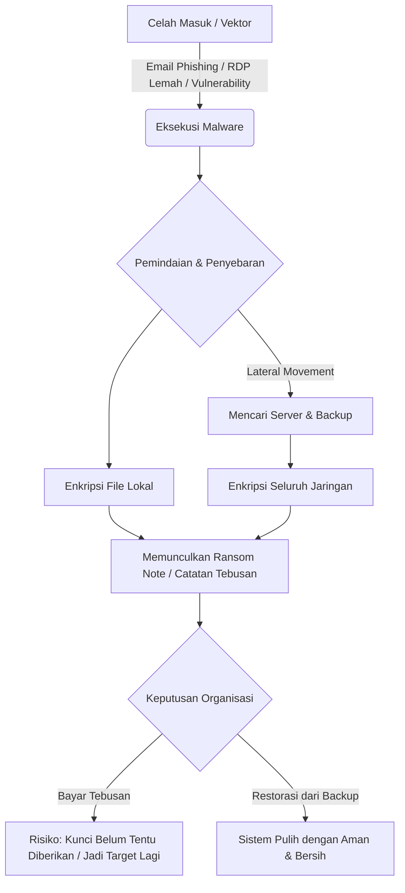

# 🧬 Kesadaran Keamanan Siber: Memahami Ransomware

Ransomware merupakan salah satu ancaman paling berbahaya dan merusak di dunia siber saat ini. Berbeda dengan virus biasa yang hanya merusak sistem atau mencuri data secara diam-diam, ransomware bertindak seperti **penyandera digital** yang secara aktif menuntut tebusan uang.

---

## 🔍 Apa itu Ransomware?

Secara sederhana, **Ransomware** adalah jenis *malware* (perangkat lunak berbahaya) yang dirancang untuk mengunci perangkat Anda atau mengenkripsi (mengacak) file di dalamnya sehingga tidak dapat diakses. 

> [!TIP]
> **Analogi Sederhana:**
> Bayangkan seseorang menyelinap ke rumah Anda, memasukkan semua dokumen berharga dan foto keluarga Anda ke dalam brankas baja yang sangat kuat, lalu pergi membawa kuncinya. Orang tersebut kemudian meninggalkan memo di meja Anda: *"Jika Anda ingin dokumen Anda kembali, kirimkan uang 100 juta rupiah ke rekening saya dalam waktu 48 jam, atau dokumen Anda akan dibakar."* Itulah cara kerja ransomware di dunia digital.

---

## 🔄 Alur Serangan Ransomware

Bagaimana ransomware bisa masuk dan menginfeksi sistem? Berikut adalah alurnya dalam diagram Mermaid:

---

## 🚨 Studi Kasus Terbesar Indonesia: Serangan PDNS 2 (Juni 2024)

Indonesia mengalami salah satu insiden siber nasional terburuk dalam sejarah ketika **Pusat Data Nasional Sementara 2 (PDNS 2)** di Surabaya diserang ransomware pada 20 Juni 2024.

*   **Varian Ransomware:** **Brain Cipher**, yang diidentifikasi oleh BSSN sebagai varian pengembangan dari ransomware global **LockBit 3.0**. Pelaku menggunakan *builder* LockBit 3.0 yang bocor di internet untuk memodifikasi enkripsinya.
*   **Dampak Serangan:**
    *   Melumpuhkan lebih dari **210 instansi pemerintah**, baik di tingkat pusat maupun daerah.
    *   Layanan publik vital terhenti total, termasuk **sistem keimigrasian** di seluruh bandara internasional (menyebabkan antrean manual berjam-jam), sistem pendaftaran beasiswa, hingga portal layanan kementerian.
*   **Tuntutan Tebusan:** Kelompok peretas meminta tebusan sebesar **USD 8 Juta** (sekitar Rp131 Miliar) untuk memberikan kunci dekripsi.
*   **Respons Pemerintah:** Pemerintah Indonesia secara tegas menolak membayar uang tebusan dan memilih melakukan pemulihan mandiri serta migrasi sistem ke infrastruktur cadangan (*cloud*).
*   **Fakta Menarik:** Pada awal Juli 2024, kelompok peretas Brain Cipher secara mengejutkan merilis kunci dekripsi gratis kepada pemerintah Indonesia disertai permohonan maaf publik, dengan menyatakan bahwa serangan ini ditujukan sebagai "uji penetrasi" untuk menyadarkan pentingnya pendanaan dan tata kelola keamanan siber nasional yang lebih baik.

---

## 🛡️ Langkah Mitigasi & Pencegahan (Standar BSSN)

Mengatasi ransomware setelah data terenkripsi sangatlah sulit. Kunci utamanya adalah **pencegahan** sebelum infeksi terjadi:

### 1. Strategi Backup 3-2-1 (Pertahanan Terkuat)
Memiliki cadangan data (*backup*) yang aman adalah satu-satunya cara mengabaikan tuntutan pemeras:
*   Simpan minimal **3 salinan** data Anda.
*   Gunakan **2 media penyimpanan** berbeda (misalnya: SSD Eksternal dan Cloud Storage).
*   Simpan **1 salinan secara offline** (*air-gapped* / tidak terhubung sama sekali ke internet/jaringan).

### 2. Keamanan Akses Jaringan (Hardening)
*   **Matikan RDP (Remote Desktop Protocol)** jika tidak digunakan. Jika terpaksa digunakan, amankan di balik VPN instansi dan batasi IP yang diizinkan.
*   Nonaktifkan protokol lama yang rentan seperti **SMBv1** atau **SMBv2**.

### 3. Pembaruan Rutin & CSIRT
*   Selalu perbarui sistem operasi (Windows, Linux) dan aplikasi sesegera mungkin saat *patch* keamanan dirilis.
*   Pastikan antivirus/EDR (*Endpoint Detection and Response*) aktif dengan definisi virus terbaru.
*   Jika terjadi insiden di instansi Anda, segera laporkan ke Tim CSIRT (*Computer Security Incident Response Team*) internal atau BSSN untuk isolasi jaringan agar ransomware tidak menyebar (*lateral movement*).
