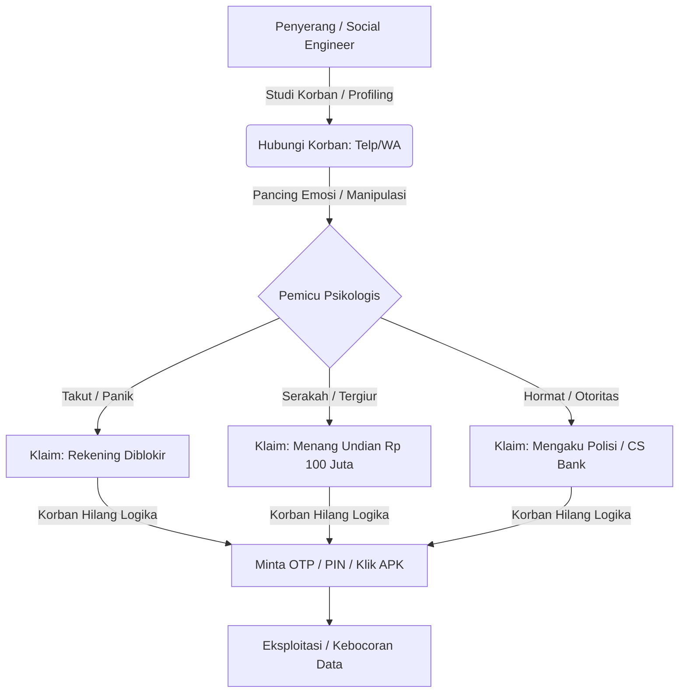

# 🧠 Kesadaran Keamanan Siber: Rekayasa Sosial (Social Engineering)

> *"Amatir menyerang sistem keimigrasian atau jaringan komputer. Profesional menyerang manusia."*

Kalimat di atas sangat populer di kalangan praktisi keamanan informasi. Kalimat ini bukan isapan jempol belaka. Mengapa peretas bersusah payah mencari kerentanan keamanan perangkat lunak (*zero-day*) yang mahal dan rumit, jika mereka bisa mendapatkan kata sandi admin hanya dengan menanyakan atau memanipulasinya lewat telepon?

Manusia adalah **mata rantai terlemah** (*the weakest link*) dalam rantai pertahanan keamanan informasi. Keamanan siber terbaik sekaliber militer pun akan runtuh seketika jika penggunanya menyerahkan kunci akses secara sukarela kepada penyerang.

---

## 🔍 Apa itu Social Engineering (Soceng)?

**Social Engineering** atau Rekayasa Sosial adalah teknik memanipulasi psikologis seseorang sehingga ia melakukan tindakan tertentu (seperti mengunduh file berbahaya) atau membocorkan informasi rahasia (seperti kata sandi, PIN, atau kode OTP) tanpa sadar bahwa ia sedang ditipu.

---

## 🧠 5 Pemicu Psikologis Utama yang Dimanfaatkan Penipu

Penipu siber dilatih untuk mengeksploitasi emosi dasar manusia. Mereka merancang skenario agar korban bertindak menggunakan **emosi**, bukan logika. Berikut 5 taktik psikologis yang paling sering digunakan:

1.  **Ketakutan & Kepanikan (Fear):**
    *   *Skenario:* *"Halo, kami dari Kepolisian Daerah. Anak Anda tertangkap dalam kasus narkoba..."* atau *"Sistem mendeteksi transaksi mencurigakan di kartu kredit Anda. Rekening Anda akan diblokir permanen dalam 30 menit jika tidak dikonfirmasi."*
    *   *Tujuan:* Membuat korban panik sehingga langsung mengikuti instruksi penipu tanpa berpikir panjang.
2.  **Ketergesa-gesaan (Urgency):**
    *   *Skenario:* *"Sisa waktu penawaran hadiah hanya 5 menit lagi!"* atau *"Konfirmasi kode OTP ini dalam waktu 60 detik!"*
    *   *Tujuan:* Mencegah korban untuk berhenti sejenak, merenung, atau berkonsultasi dengan orang lain.
3.  **Keserakahan & Keuntungan (Greed):**
    *   *Skenario:* *"Selamat! Anda memenangkan undian dari Telkomsel sebesar Rp 50 Juta. Silakan aktivasi kode berikut..."* atau *"Dapatkan investasi dengan keuntungan 50% setiap minggu!"*
    *   *Tujuan:* Membutakan logika korban dengan iming-iming materi instan.
4.  **Kewibawaan & Otoritas (Authority):**
    *   *Skenario:* Penipu menelepon menggunakan nada bicara yang tegas dan profesional, mengaku sebagai Petugas Pajak, Customer Service Bank BCA, Pejabat BSSN, atau Direktur Utama perusahaan tempat korban bekerja.
    *   *Tujuan:* Memanfaatkan rasa segan, hormat, atau takut korban terhadap sosok pemimpin atau aparat hukum.
5.  **Rasa Saling Menolong & Simpati (Sympathy/Helpfulness):**
    *   *Skenario:* Akun WhatsApp teman Anda dibajak. Penipu menggunakan akun tersebut untuk mengirim pesan: *"Bro, dompet gua ilang nih, boleh pinjem 500 ribu dulu gak buat naik ojek? Ntar malem gua ganti."*
    *   *Tujuan:* Memanfaatkan kebaikan hati dan kepercayaan antar-teman.

---

## 🚨 Skenario Soceng Nyata di Indonesia

*   **Pencurian OTP Shopee/Gojek:**
    Penipu mengaku sebagai kurir atau merchant, menghubungi korban dengan alasan *"Saya salah memasukkan nomor HP untuk kirim kode voucher, kodenya malah masuk ke WA Ibu/Bapak. Boleh tolong sebutkan 5 angka yang masuk?"*. Kode 5 angka tersebut sebenarnya adalah **OTP login akun Shopee/Gojek** milik korban. Begitu diberikan, akun diambil alih, dan saldo e-wallet disedot habis.
*   **Modus SIM Swap (Duplikasi Kartu SIM):**
    Penipu mengumpulkan data pribadi korban (Nama lengkap, NIK, tanggal lahir) dari kebocoran data di internet. Menggunakan data ini, penipu mendatangi gerai operator seluler dan mengaku sebagai korban yang kehilangan kartu SIM untuk membuat SIM card baru. Begitu SIM card baru aktif, kartu SIM asli milik korban mati. Penipu kemudian menggunakan nomor HP tersebut untuk menerima OTP dan meretas akun bank korban.

---

## 🛡️ Kebiasaan Defensif (Defensive Habits)

Untuk membentengi diri Anda dari manipulasi psikologis, terapkan **Tiga Hukum Emas Keamanan Informasi**:

*   ⚠️ **Hukum 1: Tenang & Perlambat (Slow Down)**
    Jika ada orang asing menelepon atau mengirim pesan dengan nada mendesak/menakut-nakuti, **tarik napas dalam-dalam**. Matikan telepon secara sepihak. Jangan biarkan diri Anda didikte oleh kepanikan.
*   🔍 **Hukum 2: Verifikasi Secara Mandiri**
    Jangan pernah mempercayai nomor telepon yang menghubungi Anda secara mendadak. Jika mereka mengaku dari Bank BCA, matikan telepon, cari nomor resmi Halo BCA (1500888), lalu hubungi mereka sendiri untuk menanyakan kebenarannya.
*   🔒 **Hukum 3: OTP, PIN, & Password adalah Suci**
    Petugas bank resmi, BSSN, polisi, maupun pihak manapun **TIDAK PERNAH** meminta kata sandi, PIN ATM, atau kode OTP Anda. Jika ada yang meminta informasi tersebut dengan alasan apapun (termasuk audit sistem atau pembatalan transaksi), dapat dipastikan **100% adalah penipuan**.
